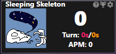
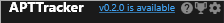

# APTTracker

APTTracker is a plugin for [Hearthstone Deck Tracker (HDT)](https://hsreplay.net/downloads/) which is a companion app for Hearthstone. APTTracker is only enabled in Battlegrounds.

## Installation

- Install [Hearthstone Deck Tracker (HDT)](https://hsreplay.net/downloads/) if needed.
- (Optional) Review HDT [plugin installation instructions](https://github.com/HearthSim/Hearthstone-Deck-Tracker/wiki/Available-Plugins#how-to-install-plugins)
- Download [latest release](https://github.com/judecorp/APTTracker/releases/latest)
- Copy `APTTracker.dll` into the plugins subfolder (default: `%appdata%\Hearthstone Deck Tracker\Plugins`) or click `Options -> Tracker -> Plugins -> Plugins Folder`.
- (Re-)start HDT.
- Enable APTTracker in `Options -> Tracker -> Plugins`

## How to Update

- A link will appear in the plugin when an update is available.
- Download [latest release](https://github.com/judecorp/APTTracker/releases/latest)
- Replace existing `APTTracker.dll` with newly downloaded one in the plugins subfolder (default: `%appdata%\Hearthstone Deck Tracker\Plugins`) or click `Options -> Tracker -> Plugins -> Plugins Folder`.

## Features

- Number go up !!!
- Obsessively accurate tracking covering every feature of the game.
- Details panel shows breakdown of what actions/events have occurred during the turn.
- Hand-drawn rank images full of Hearthstone memes.
- Records record highest APT.

It is fun to be able to look at APTTracker after a turn and see:

1. how good the APM was
2. how many of an event we care about. Ex. Playing Turbo Hogrider and seeing how many choose-ones were played. Or playing Abberations and seeing how many discards.

My dream is that streamers will use it so I can see how big APM is of top players :)
It is also neat to be able to compare APM of different boards/comp.

## What is an action?

The philosophy I have used is that everything that is a click or a decision is one action. For example Dark Gifting is one action. Choosing the Dark Gift from the discover is another action.

Playing a choose one card is two actions, unless you are getting both sides of the choose one, then it is two.

The details panel supports counters for some non-action events when it is useful. For instance discards which happen automatically are not counted as actions, but they are included in the discards counter because it is more useful.

## License

GNU General Public License v3.0 or later

See [LICENSE](LICENSE) to see the full text.
